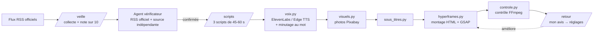

# Studio d'actu IA

Un studio automatisé qui repère chaque matin l'actualité de l'IA, **la vérifie**, puis la transforme en vidéo courte verticale (TikTok, Reels, Shorts) avec voix off, photos, sous-titres animés et effets sonores.

Projet de portfolio réalisé en 10 semaines pour une recherche d'alternance en IA.

## Le problème

L'IA évolue très vite : de nouveaux modèles et outils sortent chaque semaine. Suivre l'actualité prend du temps, et beaucoup de vidéos relaient des rumeurs sans les vérifier. Le studio fait le tri, prouve chaque news par deux sources, et produit la vidéo sans montage à la main.

## La chaîne



1. **Veille** (`/veille`) : lecture des blogs officiels, base SQLite sans doublons, chaque news notée sur 10 par Claude, top 3 gardé.
2. **Vérification** (agent `verificateur`) : une news n'est confirmée que par le flux RSS officiel **et** une source indépendante. Sinon elle est « incertaine » et ne devient pas une vidéo.
3. **Scripts** (`/scripts`) : 3 scripts par news confirmée, 2 styles de montage (dynamique ou explicatif), des idées d'images.
4. **Production** (`veille/matin.py`) : voix off, photos, sous-titres au mot près, montage façon Shorts (accroche, mots-clés en couleur, emojis, zooms, transitions, sons).
5. **Contrôle** (`veille/controle.py`) : format 1080x1920, durée, volume -14 LUFS, crête, silences, écrans noirs, images figées, photos floues ou en double. Verdict ok / à revoir / bloquant.
6. **Auto-amélioration** (`/retour`) : mon avis sur une vidéo modifie les réglages de montage (`veille/reglages_montage.json`), la leçon est retenue et la vidéo remontée.

Une tâche planifiée lance toute la chaîne chaque matin vers 7 h.

## Résultats mesurés

Chiffres réels produits par `veille/benchmark.py` (détail dans [docs/BENCHMARK.md](docs/BENCHMARK.md)) :

| Mesure | Valeur |
|---|---|
| News collectées → notées → vérifiées | 180 → 28 → 6 |
| News confirmées / incertaines / fausses | 4 / 2 / 0 |
| Scripts écrits | 12 |
| Vidéos montées et validées par le contrôle | 4 sur 4 |
| Format | 1080x1920 à 30 i/s, 46 s |
| Volume moyen | -14,4 LUFS (cible -14) |
| Temps de montage | 3 vidéos en 12 min, environ 4 min par vidéo |

Ce que montre l'entonnoir : environ une news sur 45 collectées devient une vidéo, et un tiers des news du top est écarté faute de preuve suffisante.

## Technologies

- **Python** et **SQLite** : toute la chaîne, sans framework.
- **Claude Code** : skills `/veille`, `/scripts`, `/retour` et un agent vérificateur avec recherche web.
- **Voix** : ElevenLabs (`eleven_v4`, balises d'émotion) avec Edge TTS en secours gratuit.
- **Images** : API Pixabay, crédits des photographes conservés.
- **Montage** : [HyperFrames](https://www.npmjs.com/package/hyperframes) (page HTML + GSAP filmée dans Chrome), FFmpeg en secours ; projet CapCut possible avec pyCapCut.
- **Contrôle qualité** : FFmpeg / ffprobe (ebur128, blackdetect, freezedetect, silencedetect).

## Installation

```bash
python -m venv .venv
.venv/Scripts/pip install -r requirements.txt
```

Il faut aussi FFmpeg, Node.js (pour `npx hyperframes`) et Chrome. Les clés `ELEVENLABS_API_KEY` (facultative) et `PIXABAY_API_KEY` vont dans un fichier `.env`, jamais commité.

## Utilisation

Dans Claude Code, depuis la racine du projet :

1. `/veille` : news du jour, notées et vérifiées.
2. `/scripts` : scripts des news confirmées.
3. `python veille/matin.py` : voix, photos, sous-titres, montage et contrôle (journal dans `data/journal/`).
4. `/retour` : mon avis sur la vidéo, pour que le studio s'améliore.
5. `python veille/benchmark.py` : les chiffres du studio dans `docs/BENCHMARK.md`.

## Choix techniques

- **Vérifier avant de produire** : une page bloquée n'est pas une preuve ; le flux RSS officiel sert de preuve de publication.
- **Un moteur payant, un secours gratuit** : si ElevenLabs échoue, Edge TTS prend le relais et la chaîne continue.
- **Réglages hors du code** : tous les choix de montage sont dans un fichier JSON que `/retour` peut modifier.
- **Contrôle automatique** : aucune vidéo n'est « prête » sans passer les mesures FFmpeg.

## Limites et suites

- Les vidéos ne sont pas encore publiées automatiquement : la publication reste une décision humaine.
- Les photos d'illustration sont génériques ; des captures officielles ou des images générées seraient plus précises.
- L'accroche reprend parfois l'angle du script et manque de punch ; le ton doit être plus sobre sur les sujets sensibles.

## Statut

✅ Les 10 semaines du plan sont terminées : veille, vérification, scripts, voix, sous-titres, visuels, montage, contrôle, benchmark et portfolio.
